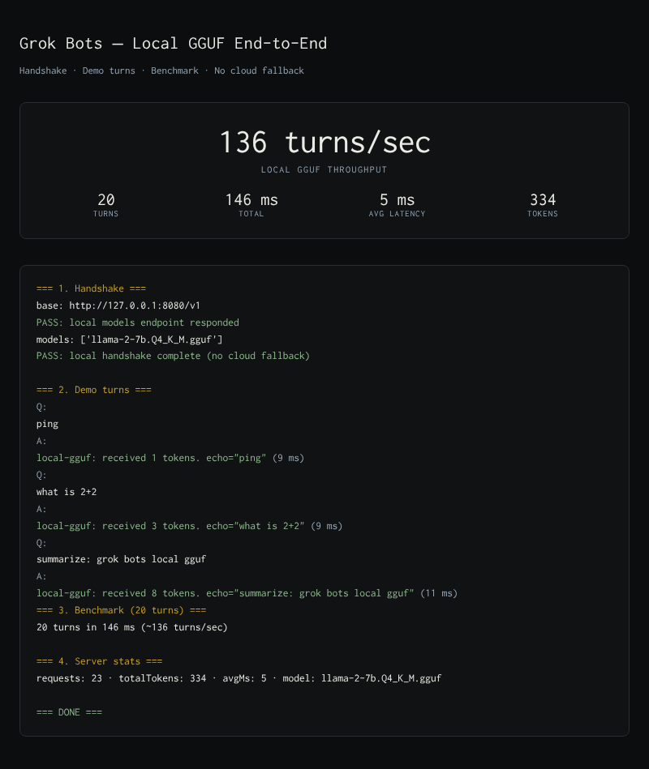
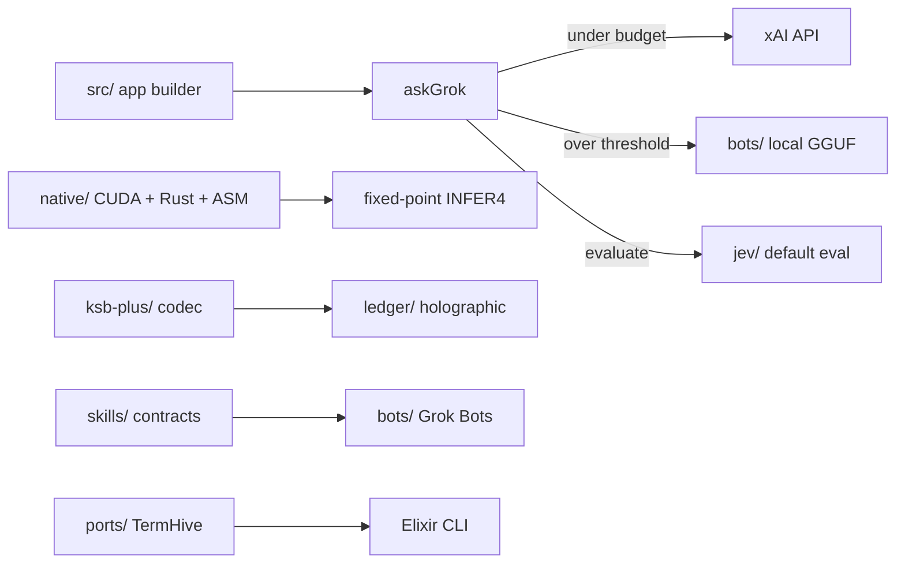

# OpenGrok

OpenGrok is a production repository. Rust is the primary language (inference, ledger, accounting, PyTorch bridge). TypeScript in `src/` is the UI layer only. Jev is the default evaluation model.

**Repository:** https://github.com/AHMADALIPARR/OpenGrok  
**License:** GNU Affero General Public License v3.0 ([LICENSE](LICENSE))  
**Where files belong:** [docs/INDEX.md](docs/INDEX.md)

## Demo



<div align="center">

**136 turns/sec** · 20 turns · 146 ms · 5 ms avg · 334 tokens · no cloud fallback

</div>

## Architecture



## Repository map

| Mark | Path | Purpose |
|:----:|------|---------|
| ▸ | `.grok` | Skills and references used by the app-builder agent. |
| ✓ | `AGENTS.md` | Root file. |
| ✓ | `LICENSE` | Root file. |
| ✓ | `README.md` | Root file. |
| ▸ | `archive` | Review material only. Nothing here is required to build. |
| ▸ | `attachments` | Conversation attachments preserved for review. |
| ✓ | `attention_tc.cu` | Root file. |
| ▸ | `bots` | Grok Bots GGUF support, microagent notes, local demo and benchmark. |
| ▸ | `docs` | Section map and cross-cutting notes. |
| ▸ | `emacs` | Emacs VM and Helm starter configs. |
| ✓ | `eslint.config.mjs` | Root file. |
| ✓ | `fixed-point` | Root file. |
| ▸ | `jev` | Default evaluation model. NRSE engine, reduced GGUF, REPL. |
| ▸ | `ksb-plus` | K-language binary serialization. Layer 0 envelope, Layer 1 tables, codec verification. |
| ▸ | `ledger` | Holographic append-only ledger for tick-data and order books. |
| ✓ | `main.rs` | Root file. |
| ▸ | `migrations` | Database migrations applied by npm run db:migrate. |
| ▸ | `native` | CUDA Tensor Core kernels, Rust FFI, MACROGROK assembly, fixed-point engine. |
| ✓ | `package-lock.json` | Root file. |
| ✓ | `package.json` | Root file. |
| ▸ | `ports` | Ports of external systems (TermHive Elixir/PHP messaging). |
| ▸ | `public` | Static assets. |
| ▸ | `screenshots` | Captured UI and demo images. |
| ▸ | `scripts` | Build, migrate, preview, and maintenance scripts. |
| ▸ | `server` | Server entry and server-only routes. |
| ▸ | `skills` | Product skill contracts. Unified index under skills/all/. |
| ▸ | `src` | App builder UI and libraries (TanStack Start, React). Includes askGrok and token accounting. |
| ✓ | `tavily.rs` | Root file. |
| ✓ | `tma.ptx` | Root file. |
| ✓ | `transformer.rs` | Root file. |
| ✓ | `tsconfig.json` | Root file. |
| ✓ | `vercel.json` | Root file. |
| ✓ | `vite.config.ts` | Root file. |

## Full tree

✓ file · ▸ directory

✓ `.gitignore`

### ▸ `.grok/`

Skills and references used by the app-builder agent.

```
✓ `README.md`
✓ `app-env.json`
▸ `references`
  ✓ `browser-qa.md`
  ✓ `data-and-auth.md`
  ✓ `deploy-target.md`
  ✓ `generated-art.md`
  ✓ `hibernate-revive.md`
  ✓ `scaffold.md`
▸ `skills`
  ▸ `auth`
    ✓ `SKILL.md`
    ▸ `references`
      ✓ `grok-identity.md`
      ✓ `per-user-data.md`
      ✓ `prewired-and-env.md`
      ✓ `session-ui.md`
      ✓ `sign-in-methods.md`
      ✓ `wiring.md`
  ▸ `building-games`
    ✓ `SKILL.md`
    ▸ `references`
      ✓ `3d-libs.md`
      ✓ `ai-pathfinding.md`
      ✓ `audio.md`
      ✓ `babylon.md`
      ✓ `collision-physics.md`
      ✓ `ecs-architecture.md`
      ✓ `game-feel-juice.md`
      ▸ `genres`
        ✓ `board-card-chess.md`
        ✓ `endless-runner.md`
        ✓ `fps.md`
        ✓ `platformer-2d.md`
        ✓ `puzzle-match3-tetris.md`
        ✓ `racing-kart.md`
        ✓ `topdown-twin-stick.md`
        ✓ `tower-defense.md`
        ✓ `voxel-minecraft.md`
      ✓ `input.md`
      ✓ `phaser.md`
      ✓ `procedural-generation.md`
      ✓ `save-persistence.md`
      ✓ `threejs-foundational.md`
  ▸ `controls`
    ✓ `SKILL.md`
  ▸ `design-ui`
    ✓ `SKILL.md`
    ▸ `references`
      ✓ `animations.md`
      ✓ `performance.md`
      ✓ `refined-ui.md`
      ✓ `surfaces.md`
      ✓ `typography.md`
  ▸ `game-animation-frames`
    ✓ `SKILL.md`
  ▸ `game-asset-core`
    ✓ `SKILL.md`
  ▸ `game-character-consistency`
    ✓ `SKILL.md`
  ▸ `game-tilesets`
    ✓ `SKILL.md`
  ▸ `game-ui-icons`
    ✓ `SKILL.md`
  ▸ `generate2dmap`
    ✓ `LICENSE`
    ✓ `SKILL.md`
    ✓ `SOURCE.md`
    ▸ `references`
      ✓ `deliverables.md`
      ✓ `layered-map-contract.md`
      ✓ `map-strategies.md`
      ✓ `object-production-gate.md`
      ✓ `pipeline.md`
      ✓ `prop-pack-contract.md`
      ✓ `side-scroll-stages.md`
    ▸ `scripts`
      ✓ `compose_layered_preview.py`
      ✓ `extract_prop_pack.py`
  ▸ `generate2dsprite`
    ✓ `LICENSE`
    ✓ `SKILL.md`
    ✓ `SOURCE.md`
    ▸ `references`
      ✓ `modes.md`
      ✓ `prompt-rules.md`
    ▸ `scripts`
      ✓ `generate2dsprite.py`
      ✓ `make_layout_guide.py`
  ▸ `imagine-grok-build`
    ✓ `SKILL.md`
  ▸ `multiplayer-p2p`
    ✓ `SKILL.md`
    ▸ `references`
      ✓ `react-binding.md`
      ✓ `signaling-relay.md`
  ▸ `neon`
    ✓ `SKILL.md`
  ▸ `og`
    ✓ `SKILL.md`
    ▸ `references`
      ✓ `brand-pass.md`
      ✓ `custom-card.md`
      ✓ `favicon-and-icons.md`
      ✓ `og-type-contract.md`
      ✓ `placeholder-card.md`
      ✓ `x-banner.md`
  ▸ `threejs`
    ✓ `SKILL.md`
    ▸ `references`
      ✓ `llms-full.txt`
  ▸ `video2dsprite`
    ✓ `LICENSE`
    ✓ `SKILL.md`
    ✓ `SOURCE.md`
    ▸ `references`
      ✓ `pipeline.md`
      ✓ `prompt-rules.md`
    ▸ `scripts`
      ✓ `video2dsprite.py`
  ▸ `xai-api`
    ✓ `SKILL.md`
✓ `status`
```

✓ `.prettierrc`
✓ `AGENTS.md`
✓ `LICENSE`
✓ `README.md`

### ▸ `archive/`

Review material only. Nothing here is required to build.

```
✓ `README.md`
▸ `root-stubs`
  ✓ `README.md`
  ✓ `attention.rs`
  ✓ `attention_tc.cu`
  ✓ `fixed-point`
  ✓ `main.rs`
  ✓ `memory.rs`
  ✓ `tavily.rs`
  ✓ `tma.ptx`
  ✓ `transformer.rs`
```


### ▸ `attachments/`

Conversation attachments preserved for review.

```
✓ `Pasted Text.txt`
```

✓ `attention_tc.cu`

### ▸ `bots/`

Grok Bots GGUF support, microagent notes, local demo and benchmark.

```
✓ `README.md`
▸ `demo`
  ✓ `README.md`
  ✓ `gguf-demo.png`
  ✓ `run.sh`
  ✓ `server.mjs`
✓ `example.env`
✓ `microagent.md`
✓ `repl.sh`
▸ `skills`
  ▸ `gguf-local`
    ✓ `SKILL.md`
```


### ▸ `docs/`

Section map and cross-cutting notes.

```
✓ `INDEX.md`
```


### ▸ `emacs/`

Emacs VM and Helm starter configs.

```
✓ `README.md`
▸ `helm`
  ✓ `README.md`
▸ `vm`
  ✓ `README.md`
  ✓ `example.vm`
```

✓ `eslint.config.mjs`
✓ `fixed-point`

### ▸ `ksb-plus/`

K-language binary serialization. Layer 0 envelope, Layer 1 tables, codec verification.

```
✓ `.gitignore`
✓ `LICENSE`
✓ `README.md`
▸ `docs`
  ✓ `binary-format.md`
  ✓ `layer1-tables.md`
  ✓ `limitations.md`
▸ `src`
  ✓ `binary.k`
  ✓ `codec.k`
  ✓ `table.k`
▸ `t`
  ✓ `bench_codec.k`
  ✓ `run.sh`
  ✓ `t_binary.k`
  ✓ `verify_codec.k`
```


### ▸ `ledger/`

Holographic append-only ledger for tick-data and order books.

```
✓ `Cargo.toml`
✓ `README.md`
▸ `src`
  ✓ `ledger.rs`
  ✓ `main.rs`
```

✓ `main.rs`

### ▸ `migrations/`

Database migrations applied by npm run db:migrate.

```
✓ `README.md`
▸ `auth`
  ✓ `0001_auth.sql`
```


### ▸ `native/`

CUDA Tensor Core kernels, Rust FFI, MACROGROK assembly, fixed-point engine.

```
✓ `README.md`
▸ `asm`
  ✓ `infer4.asm`
▸ `cuda`
  ✓ `check_ptx.sh`
  ✓ `matrix_mul.cu`
  ✓ `tensor_core_attention.cu`
  ✓ `tma.ptx`
▸ `fixed_point`
  ✓ `Cargo.toml`
  ✓ `README.md`
  ▸ `examples`
    ✓ `demo.c`
  ▸ `include`
    ✓ `macrogrok_fixed.h`
  ▸ `src`
    ✓ `fixed_point.rs`
▸ `rust`
  ✓ `attention.rs`
  ✓ `fixed_point.rs`
  ✓ `full_demo.rs`
  ✓ `lib.rs`
  ✓ `main.rs`
  ✓ `memory.rs`
  ✓ `tavily.rs`
  ✓ `transformer.rs`
```

✓ `package-lock.json`
✓ `package.json`

### ▸ `ports/`

Ports of external systems (TermHive Elixir/PHP messaging).

```
✓ `README.md`
▸ `termhive-messaging`
  ✓ `README.md`
  ▸ `elixir`
    ✓ `README.md`
    ▸ `lib`
      ▸ `termhive`
        ✓ `activity.ex`
        ✓ `agent_registry.ex`
        ✓ `application.ex`
        ✓ `cli.ex`
        ✓ `message_router.ex`
        ✓ `messaging.ex`
        ✓ `protocol.ex`
    ✓ `mix.exs`
  ▸ `php`
    ✓ `README.md`
    ▸ `src`
      ✓ `Messaging.php`
```


### ▸ `public/`

Static assets.

```
✓ `README.md`
▸ `__grok`
  ✓ `icon-180.png`
  ▸ `install`
    ▸ `assets`
      ▸ `homescreen`
        ✓ `glass-puzzle.svg`
        ✓ `glass-share.svg`
        ✓ `logo-grok.svg`
        ✓ `ob-ipad.png`
        ✓ `ob-phone.png`
        ✓ `plus.svg`
    ✓ `styles.css`
```


### ▸ `screenshots/`

Captured UI and demo images.

```
✓ `.gitkeep`
```


### ▸ `scripts/`

Build, migrate, preview, and maintenance scripts.

```
✓ `README.md`
✓ `app-env-plugin.mjs`
✓ `brand-check.mjs`
✓ `brand-check.test.mjs`
✓ `browser-guard.mjs`
✓ `browser-smoke-verdict.mjs`
✓ `browser-smoke-verdict.test.mjs`
✓ `browser-smoke.mjs`
✓ `check-auth-invariant.mjs`
✓ `check-auth-invariant.test.mjs`
✓ `grok-pwa-plugin.mjs`
✓ `grok-pwa-plugin.test.mjs`
✓ `grok-pwa-shared.d.mts`
✓ `grok-pwa-shared.mjs`
✓ `install-page.html`
✓ `migrate.mjs`
✓ `migration-plan.mjs`
✓ `migration-plan.test.mjs`
✓ `preview-thumbnail.mjs`
✓ `preview.mjs`
✓ `preview.test.mjs`
✓ `sign-out-plan.mjs`
✓ `sign-out-plan.test.mjs`
✓ `with-app-env.mjs`
✓ `with-app-env.test.mjs`
✓ `write-atomic.mjs`
✓ `write-atomic.test.mjs`
```


### ▸ `server/`

Server entry and server-only routes.

```
✓ `README.md`
▸ `middleware`
  ✓ `grok-pwa.ts`
✓ `virtual-grok-og-identity.d.ts`
```


### ▸ `skills/`

Product skill contracts. Unified index under skills/all/.

```
✓ `README.md`
▸ `all`
  ✓ `README.md`
  ▸ `bots`
    ▸ `gguf-local`
      ✓ `SKILL.md`
  ▸ `platform`
    ▸ `auth`
      ✓ `SKILL.md`
    ▸ `building-games`
      ✓ `SKILL.md`
    ▸ `controls`
      ✓ `SKILL.md`
    ▸ `design-ui`
      ✓ `SKILL.md`
    ▸ `game-animation-frames`
      ✓ `SKILL.md`
    ▸ `game-asset-core`
      ✓ `SKILL.md`
    ▸ `game-character-consistency`
      ✓ `SKILL.md`
    ▸ `game-tilesets`
      ✓ `SKILL.md`
    ▸ `game-ui-icons`
      ✓ `SKILL.md`
    ▸ `generate2dmap`
      ✓ `SKILL.md`
    ▸ `generate2dsprite`
      ✓ `SKILL.md`
    ▸ `imagine-grok-build`
      ✓ `SKILL.md`
    ▸ `multiplayer-p2p`
      ✓ `SKILL.md`
    ▸ `neon`
      ✓ `SKILL.md`
    ▸ `og`
      ✓ `SKILL.md`
    ▸ `threejs`
      ✓ `SKILL.md`
    ▸ `video2dsprite`
      ✓ `SKILL.md`
    ▸ `xai-api`
      ✓ `SKILL.md`
  ▸ `product`
    ▸ `cache-guard`
      ✓ `SKILL.md`
    ▸ `codeart2d`
      ✓ `SKILL.md`
    ▸ `generate2dmap`
      ✓ `SKILL.md`
    ▸ `generate2dmedia`
      ✓ `SKILL.md`
    ▸ `generate2dsprite`
      ✓ `SKILL.md`
    ▸ `math-skills`
      ✓ `SKILL.md`
    ▸ `personas`
      ▸ `prehool`
        ✓ `SKILL.md`
    ▸ `video2dsprite`
      ✓ `SKILL.md`
▸ `cache-guard`
  ✓ `SKILL.md`
  ▸ `references`
    ✓ `mechanism.md`
  ▸ `scripts`
    ✓ `audit-session.mjs`
▸ `codeart2d`
  ✓ `SKILL.md`
▸ `generate2dmap`
  ✓ `SKILL.md`
▸ `generate2dmedia`
  ✓ `SKILL.md`
▸ `generate2dsprite`
  ✓ `SKILL.md`
▸ `math-skills`
  ✓ `MATH_SKILLS.md`
  ✓ `SKILL.md`
  ✓ `math_skills_master_seal.json`
▸ `personas`
  ▸ `prehool`
    ✓ `PERSONA.md`
    ✓ `SKILL.md`
▸ `video2dsprite`
  ✓ `SKILL.md`
```


### ▸ `src/`

App builder UI and libraries (TanStack Start, React). Includes askGrok and token accounting.

```
✓ `README.md`
▸ `components`
  ✓ `preview-host-bridge.tsx`
▸ `lib`
  ▸ `ai`
    ✓ `accounting.test.ts`
    ✓ `ask-grok.server.ts`
    ✓ `ask-grok.test.ts`
    ✓ `ask-with-accounting.ts`
    ✓ `token-accounting.ts`
  ▸ `app-data`
    ✓ `app-data.test.ts`
    ✓ `client.server.ts`
    ✓ `errors.ts`
    ✓ `index.ts`
    ✓ `login.ts`
    ✓ `readiness-schedule.test.ts`
    ✓ `readiness-schedule.ts`
    ✓ `readiness.ts`
    ✓ `server-only.ts`
    ✓ `types.ts`
    ✓ `use-connector-readiness.ts`
  ▸ `auth`
    ✓ `client.ts`
    ✓ `email-password.ts`
    ✓ `gate-identity.server.ts`
    ✓ `gate-identity.test.ts`
    ✓ `gate-session-marker.ts`
    ✓ `gate-session.server.ts`
    ✓ `gates.tsx`
    ✓ `isolation.server.ts`
    ✓ `middleware.ts`
    ✓ `pglite-dialect.ts`
    ✓ `popup.server.ts`
    ✓ `preview.ts`
    ✓ `provider.tsx`
    ✓ `providers.ts`
    ✓ `server.ts`
    ✓ `sign-in-gate.test.ts`
    ✓ `sign-in-gate.ts`
    ✓ `use-current-user.ts`
    ✓ `verify.server.ts`
  ✓ `db.ts`
  ✓ `env.server.ts`
  ✓ `error-component.tsx`
  ▸ `multiplayer`
    ✓ `index.ts`
    ✓ `p2p.ts`
  ✓ `preview-embedder-origin.ts`
  ✓ `preview-host-bridge.ts`
  ✓ `preview-path-prefix.test.ts`
  ✓ `preview-path-prefix.ts`
```

✓ `tavily.rs`
✓ `tma.ptx`
✓ `transformer.rs`
✓ `tsconfig.json`
✓ `vercel.json`
✓ `vite.config.ts`

## Jev

**Default evaluation model.** Non-regressive semantic engine plus reduced GGUF. Returns a byte span or `[-1, -1]`. Does not generate prose.

| Path | Purpose |
|------|---------|
| `jev/engine/` | NRSE. Perl. `locate` / `audit` / `extract`. |
| `jev/models/jev.gguf` | Evaluation artifact. |
| `jev/repl/repl.py` | Read-Eval-Print loop. |
| `jev/eval-default.json` | Declares Jev as the default. |

```bash
python3 jev/repl/repl.py --demo
python3 jev/repl/repl.py
perl jev/engine/nrse.pl locate jev/engine/tests/fixture.txt balance
```

## Quick start

```bash
npm install
npm run dev          # http://localhost:8080
npm test
npm run typecheck
```

Set `XAI_API_KEY` for cloud `askGrok`. Over the free-tier token threshold the call hands off to the local GGUF endpoint (`OPENAI_BASE_URL`).

## License

GNU Affero General Public License v3.0. See [LICENSE](LICENSE).
